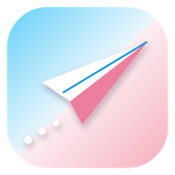

<p align="center">
  
</p>

<h1 align="center">TransGram Desktop</h1>

<p align="center">
  An <b>unofficial</b> Telegram client in trans-flag blue, pink and white.<br>
  一个蓝粉白跨性别旗配色的<b>非官方</b> Telegram 客户端。
</p>

---

TransGram Desktop is based on [Telegram Desktop][tdesktop] and uses the [Telegram API][telegram_api]. It is **not affiliated with or endorsed by Telegram**.

TransGram Desktop 基于 [Telegram Desktop][tdesktop]，使用 [Telegram API][telegram_api]，**与 Telegram 官方无关，也未经其认可**。

## Features / 功能

| | English | 中文 |
|---|---|---|
| 🏳️‍⚧️ | Built-in **TransGlass** day and night themes in trans-flag blue `#5BCEFA`, pink `#F5A9B8` and white, with gradient wallpapers | 内置 **TransGlass** 浅色和深色主题，跨性别旗的蓝 `#5BCEFA`、粉 `#F5A9B8`、白三色，配渐变壁纸 |
| 🔲 | Rounder corners on bubbles, buttons, boxes and the emoji panel | 消息气泡、按钮、弹窗、表情面板圆角更大 |
| 🪟 | Frosted-glass chat header and compose bar that let the wallpaper show through | 聊天顶栏和输入栏为毛玻璃效果，透出背后的壁纸 |
| 🛡️ | **NSFW protection** (off by default): masks photos, videos and albums in chats marked 18+ or porn-restricted on any platform; tap to reveal one | **NSFW保护**（默认关）：被标为 18+ 或在任一平台被标为 porn 的群和频道，其中的图片、视频、相册会被遮罩，点一下才显示 |
| 🌐 | **Bilingual translation** (on by default): the original text on top, the translation quoted below | **双语翻译**（默认开）：原文在上，译文以引用块显示在下面 |
| 💬 | Whole-chat translation without Premium | 免费用户也可以翻译整个聊天 |
| 👥 | Up to **10 accounts** without Premium | 不需要 Premium 也能登录最多 **10 个账号** |

The NSFW protection and the bilingual translation toggles are in the main menu, right below **Night Mode**.

NSFW保护和双语翻译的开关都在主菜单里，就在 **Night Mode** 下面。

TransGram never bypasses Telegram's own sensitive-content or age-verification rules. NSFW protection only adds masks, it never removes them.

TransGram 不会绕过 Telegram 自身的敏感内容规则和年龄验证。NSFW保护只会增加遮罩，不会去掉遮罩。

## Download / 下载

Windows 64-bit builds are on the [Releases][releases] page. Unzip and run `TransGram.exe`; keep the `modules` folder next to it.

Windows 64 位版本在 [Releases][releases] 页面下载。解压后运行 `TransGram.exe`，`modules` 文件夹要和它放在一起。

TransGram uses its own data folder, so it never touches an installed official Telegram Desktop. Auto-update is disabled, so an official update can never overwrite it.

TransGram 使用自己的数据目录，不会影响已安装的官方 Telegram Desktop。自动更新已关闭，官方更新不会覆盖它。

## Building / 编译

Follow the official [Windows build instructions][win] (also [macOS][mac], [Linux][linux]).

按照官方的 [Windows 编译说明][win] 操作（也有 [macOS][mac]、[Linux][linux] 的说明）。

Two things differ from upstream:

和官方有两点不同：

1. **Use your own API credentials.** Get `api_id` and `api_hash` at [my.telegram.org][my_telegram]. Never commit them to the repository.
   **请使用自己的 API 凭据。** 在 [my.telegram.org][my_telegram] 申请 `api_id` 和 `api_hash`，不要提交进仓库。
2. **Disable auto-update** when configuring:
   配置时**关闭自动更新**：

```bat
configure.bat x64 -D TDESKTOP_API_ID=YOUR_API_ID -D TDESKTOP_API_HASH=YOUR_API_HASH -D DESKTOP_APP_DISABLE_AUTOUPDATE=ON
```

On a system with a non-UTF-8 code page (for example Chinese, 936), set `CL=/utf-8` before building.

如果系统代码页不是 UTF-8（例如中文系统的 936），编译前先设置 `CL=/utf-8`。

The UI library `lib_ui` is part of this repository, not a submodule, because TransGram changes its corner radii and adds glass colors.

UI 库 `lib_ui` 直接放在本仓库里，不是子模块，因为 TransGram 修改了其中的圆角并加入了玻璃色。

## License / 许可证

TransGram Desktop is published under GPLv3 with OpenSSL exception, same as Telegram Desktop. The license is available [here][license].

TransGram Desktop 与 Telegram Desktop 一样，以 GPLv3（附 OpenSSL 例外）发布，许可证见[这里][license]。

## Credits / 致谢

* [Telegram Desktop][tdesktop] by the Telegram team, the base of this project
* The trans flag designed by Monica Helms

## Third-party

* Qt 6 ([LGPL](http://doc.qt.io/qt-6/lgpl.html)) and Qt 5.15 ([LGPL](http://doc.qt.io/qt-5/lgpl.html)) slightly patched
* OpenSSL 3.2.1 ([Apache License 2.0](https://openssl-library.org/source/license/apache-license-2.0.txt))
* WebRTC ([New BSD License](https://github.com/desktop-app/tg_owt/blob/master/LICENSE))
* zlib ([zlib License](http://www.zlib.net/zlib_license.html))
* LZMA SDK 9.20 ([public domain](http://www.7-zip.org/sdk.html))
* liblzma ([public domain](http://tukaani.org/xz/))
* Google Breakpad ([License](https://chromium.googlesource.com/breakpad/breakpad/+/master/LICENSE))
* Google Crashpad ([Apache License 2.0](https://chromium.googlesource.com/crashpad/crashpad/+/master/LICENSE))
* GYP ([BSD License](https://github.com/bnoordhuis/gyp/blob/master/LICENSE))
* Ninja ([Apache License 2.0](https://github.com/ninja-build/ninja/blob/master/COPYING))
* OpenAL Soft ([LGPL](https://github.com/kcat/openal-soft/blob/master/COPYING))
* Opus codec ([BSD License](http://www.opus-codec.org/license/))
* FFmpeg ([LGPL](https://www.ffmpeg.org/legal.html))
* Guideline Support Library ([MIT License](https://github.com/Microsoft/GSL/blob/master/LICENSE))
* Range-v3 ([Boost License](https://github.com/ericniebler/range-v3/blob/master/LICENSE.txt))
* Open Sans font ([Apache License 2.0](http://www.apache.org/licenses/LICENSE-2.0.html))
* Vazirmatn font ([SIL Open Font License 1.1](https://github.com/rastikerdar/vazirmatn/blob/master/OFL.txt))
* Emoji alpha codes ([MIT License](https://github.com/emojione/emojione/blob/master/extras/alpha-codes/LICENSE.md))
* xxHash ([BSD License](https://github.com/Cyan4973/xxHash/blob/dev/LICENSE))
* QR Code generator ([MIT License](https://github.com/nayuki/QR-Code-generator#license))
* CMake ([New BSD License](https://github.com/Kitware/CMake/blob/master/Copyright.txt))
* Hunspell ([LGPL](https://github.com/hunspell/hunspell/blob/master/COPYING.LESSER))
* Ada ([Apache License 2.0](https://github.com/ada-url/ada/blob/main/LICENSE-APACHE))
* zxcvbn-c ([MIT License](https://github.com/tsyrogit/zxcvbn-c/blob/master/LICENSE.txt))
* FrequencyWords by Hermit Dave ([Creative Commons Attribution-ShareAlike 4.0](https://creativecommons.org/licenses/by-sa/4.0/))

[//]: # (LINKS)
[tdesktop]: https://github.com/telegramdesktop/tdesktop
[telegram_api]: https://core.telegram.org/api
[my_telegram]: https://my.telegram.org
[releases]: https://github.com/xmlans/Transgram-Desktop/releases
[license]: LICENSE
[win]: docs/building-win.md
[mac]: docs/building-mac.md
[linux]: docs/building-linux.md
